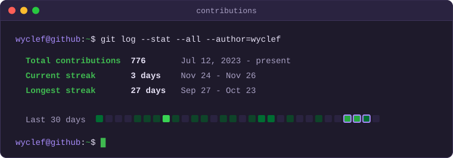

### `$ ssh wyclef@github.com`

<picture>
  <source media="(prefers-color-scheme: dark)" srcset="https://raw.githubusercontent.com/WTavasi/WTavasi/output/terminal-dark.svg" />
  <source media="(prefers-color-scheme: light)" srcset="https://raw.githubusercontent.com/WTavasi/WTavasi/output/terminal-light.svg" />
  
</picture>

<p align="center">
  <a href="https://www.linkedin.com/in/WyclefTavasi"></a>
  <a href="mailto:wycleftavasi@gmail.com"></a>
</p>

<p align="center">
  <picture>
    <source media="(prefers-color-scheme: dark)" srcset="https://readme-typing-svg.demolab.com/?font=Fira+Code&size=18&pause=1200&color=A78BFA&center=true&vCenter=true&width=600&lines=Cloud+%26+DevOps+Engineering;Linux+%26+Network+Administration;Distributed+Systems;iOS+Development+with+Swift" />
    <source media="(prefers-color-scheme: light)" srcset="https://readme-typing-svg.demolab.com/?font=Fira+Code&size=18&pause=1200&color=8250DF&center=true&vCenter=true&width=600&lines=Cloud+%26+DevOps+Engineering;Linux+%26+Network+Administration;Distributed+Systems;iOS+Development+with+Swift" />
    
  </picture>
</p>

### At a glance

- **Who:** Wyclef Tavasi, final-year Computer Science & Informatics student at Strathmore University
- **Looking for:** graduate or entry-level roles in **Cloud, DevOps and Networking**
- **Available:** full-time from **January 2027**
- **Best work:** [MzaziCare](https://github.com/WTavasi/elder-emergency-escalation) (real-time emergency escalation, 1,400+ tests) and a [consistent hashing load balancer](https://github.com/WTavasi/consistent-hashing-load-balancer)
- **Core skills:** AWS, Docker, Kubernetes, Linux, Cisco networking, Python, TypeScript
- **Experience:** Software Engineering Associate at Webmasters KE; Software Development & IT Support Intern at Delta Creative Solutions
- **Contact:** [LinkedIn](https://www.linkedin.com/in/WyclefTavasi) · [wycleftavasi@gmail.com](mailto:wycleftavasi@gmail.com)

---

### About me &nbsp;<sub><code>$ whoami</code></sub>

```text
Wyclef Tavasi. I like building systems that keep working when things go wrong: 
cloud infrastructure, Linux servers, networks, and the backends behind real-time apps.
I learn by building, and I document as I go.
```

---

### My journey &nbsp;<sub><code>$ git log --graph</code></sub>

<pre>
* <b>e3a91f0</b> (<b>HEAD -&gt; main</b>) 2027-01 open to cloud roles
* <b>7c3d1b4</b> 2026-12 BSc ICS coursework complete
* <b>5e8a0c7</b> 2026-09 AWS Academy cloud security
* <b>4b1f9e2</b> 2026-04 Webmasters KE: MzaziCare SOS
* <b>3b2f9d1</b> 2026-01 intern, Delta Creative: AWS
* <b>2d71c0a</b> 2025    Cisco CCNA track, Apple Swift
* <b>1e4f7b2</b> 2023-10 Cisco IT Essentials
| * <b>9f2c6a1</b> (<b>music</b>) 2023 principal clarinet
| * <b>61c2b7f</b> 2022-12 clarinet mentor, 13 students
| * <b>4f8e1a3</b> 2021 led a ~50-piece school band
|/
* <b>0a1b2c3</b> init: Nairobi, Kenya
</pre>

<details>
<summary><b>Read the full story</b> (roles, dates and what I did)</summary>

<pre>
2027-01  Available for full-time cloud, DevOps and
         networking roles.
2026-12  Coursework complete for the BSc in
         Informatics and Computer Science
         (Strathmore University).
2026-09  AWS Academy Graduate: Cloud Foundations
         (June) and Cloud Security Foundations.
2026-04  Software Engineering Associate, Webmasters
         KE: built the MzaziCare panic button,
         voice-triggered alerts, auto escalation and
         the login flows.
2026-01  Software Development &amp; IT Support Intern,
         Delta Creative Solutions: apps in Docker on
         AWS (EC2, S3), Grafana monitoring, on-call,
         and automated reports that turned two-week
         delays into early delivery.
music    Principal clarinet in two orchestras.
         Clarinet mentor to 13 students across
         Nairobi schools. Led a school band of about
         50 to national level and the State House
         winners' gala.
</pre>
</details>

---

### Featured projects &nbsp;<sub><code>$ ls ~/projects</code></sub>

<!-- BEGIN projects -->
<pre>
<b>$ man mzazicare</b>

<b>PROJECT</b>
    MzaziCare: emergency help for elders at home (final-year project)

<b>WHAT IT DOES</b>
    One SOS press escalates from caregiver to family to emergency services until someone accepts.
    Severity is scored from five weighted factors, with an SMS fallback when push fails, live
    updates and a full audit trail.

<b>RESULTS</b>
    + 1,417 automated tests, 12 of 12 system tests
    + escalates 57 ms after an unanswered deadline
    + care circle sees live updates in 16 ms

<b>BUILT WITH</b>
    NestJS, PostgreSQL, Redis + BullMQ, WebSockets, Flutter, React, Docker, GitHub Actions

<b>LINKS</b>
    <a href="https://github.com/WTavasi/elder-emergency-escalation">source code</a> · 287 commits · pushed 2026-11-26
</pre>

<pre>
<b>$ man load-balancer</b>

<b>PROJECT</b>
    Consistent Hashing Load Balancer (distributed systems)

<b>WHAT IT DOES</b>
    Routes HTTP requests across containerised replicas on a 512-slot hash ring with 9 virtual nodes
    per server. A heartbeat monitor replaces failed replicas on its own, and a REST API adds or
    removes them at runtime.

<b>RESULTS</b>
    + 35 unit and API tests
    + only nearby requests move when a server leaves
    + live dashboard: ring, traffic split, recovery

<b>BUILT WITH</b>
    Python, Flask, Docker, pytest

<b>LINKS</b>
    <a href="https://github.com/WTavasi/consistent-hashing-load-balancer">source code</a> · 14 commits · pushed 2026-10-05
</pre>

<pre>
<b>$ man solar-navigator</b>

<b>PROJECT</b>
    3D-Solar-Navigator (Project Stellar) (team of six)

<b>WHAT IT DOES</b>
    A Solar System scene drawn with raster graphics algorithms written from scratch in C++17. My
    part involved testing and integration.

<b>RESULTS</b>
    + built the CTest pipeline on GitHub Actions
    + 163 test cases: unit, integration and visual

<b>BUILT WITH</b>
    C++17, CMake, CTest, GitHub Actions

<b>LINKS</b>
    <a href="https://github.com/WTavasi/3D-Solar-Navigator">source code</a> · 62 commits by me · pushed 2026-11-16
</pre>
<!-- END projects -->

<details>
<summary><b>More projects</b> (iOS, machine learning, Java)</summary>

<!-- BEGIN more-projects -->
<pre>
<a href="https://github.com/WTavasi/FinaTrack">finatrack</a>     iOS money tracker with Face ID login
              Swift, UIKit, SwiftUI
<a href="https://github.com/WTavasi/MataPredict">matapredict</a>   matatu overcrowding prediction (team)
              Python, scikit-learn, Streamlit
              <a href="https://matapredict-5seiycsqmwbumdomwionkh.streamlit.app/">live demo</a>
<a href="https://github.com/WTavasi/FleaMart">fleamart</a>      store for student businesses (team)
              Java, MySQL, JDBC
</pre>
<!-- END more-projects -->

</details>

---

### Currently working on &nbsp;<sub><code>$ ps -ef</code></sub>

<!-- BEGIN ps -->
<pre>
STATUS     LAST UPDATE   PROJECT
building   2026-11-26    <a href="https://github.com/WTavasi/elder-emergency-escalation">elder-emergency-escalation</a>  <i># final-year project: real-time escalation engine</i>
uploading  -             kubernetes-deployment  <i># multi-service e-commerce app; repo soon</i>
updating   2026-09-14    <a href="https://github.com/WTavasi/FinaTrack">finatrack</a>  <i># moving the UI from UIKit to SwiftUI</i>
</pre>
<!-- END ps -->

---

### Tech stack &nbsp;<sub><code>$ cat stack.yml</code></sub>

<picture>
  <source media="(prefers-color-scheme: dark)" srcset="https://raw.githubusercontent.com/WTavasi/WTavasi/output/stack-dark.svg" />
  <source media="(prefers-color-scheme: light)" srcset="https://raw.githubusercontent.com/WTavasi/WTavasi/output/stack-light.svg" />
  
</picture>

---

### Certifications and training &nbsp;<sub><code>$ tree ~/certifications</code></sub>

<pre>
certifications/
├── aws-academy/
│   ├── cloud-foundations
│   └── cloud-security-foundations
├── cisco-netacad/
│   ├── ccna-1-introduction-to-networks
│   ├── ccna-2-switching-routing-wireless
│   ├── ccna-3-enterprise-security-automation
│   └── it-essentials
├── apple/
│   └── ios-app-development-with-swift
└── languages/
    └── dele-a1-spanish

4 directories, 8 files
</pre>

---

### What's next &nbsp;<sub><code>$ crontab -l</code></sub>

<pre>
now        studying for AWS Solutions Architect Associate
soon       publishing my Kubernetes deployment project
next       deploying a project on AWS with Terraform and CI/CD
Jan 2027   starting full-time in cloud / DevOps / networking
</pre>

---

### Outside of code &nbsp;<sub><code>$ cat ~/.interests</code></sub>

```text
music   Classically trained clarinetist. I compose, arrange and produce, and 
        perform with orchestras and live bands.
film    Star Wars (the prequels, specifically) and The Hunger Games, books included.
art     Visual art and design; always exploring something new.
```
---
### Contributions &nbsp;<sub><code>$ git log --since="1 year ago"</code></sub>

<p align="center">
<picture>
  <source media="(prefers-color-scheme: dark)" srcset="https://raw.githubusercontent.com/WTavasi/WTavasi/output/streak-dark.svg" />
  <source media="(prefers-color-scheme: light)" srcset="https://raw.githubusercontent.com/WTavasi/WTavasi/output/streak-light.svg" />
  
</picture>
</p>

<picture>
  <source media="(prefers-color-scheme: dark)" srcset="https://raw.githubusercontent.com/WTavasi/WTavasi/output/snake-dark.svg" />
  <source media="(prefers-color-scheme: light)" srcset="https://raw.githubusercontent.com/WTavasi/WTavasi/output/snake.svg" />
  
</picture>

```text
$ logout
Connection to github.com closed.
```
